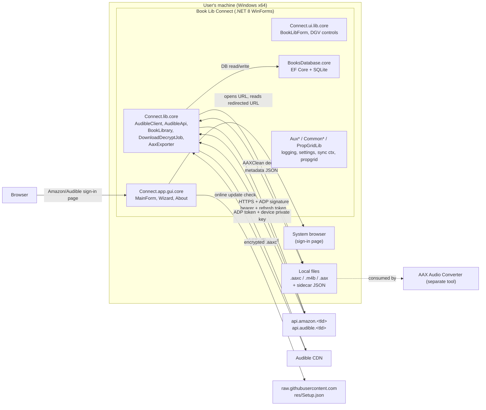
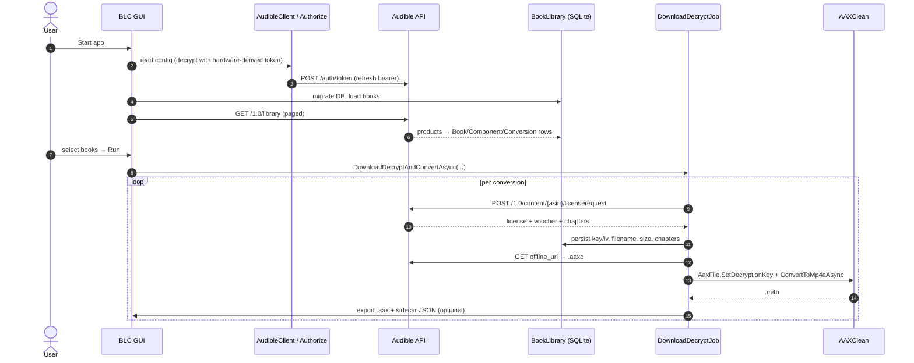
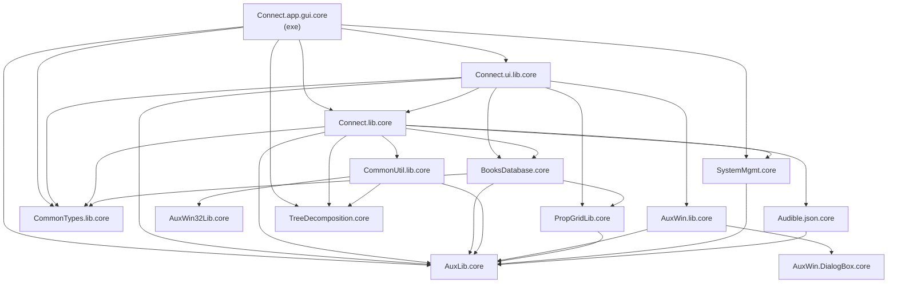
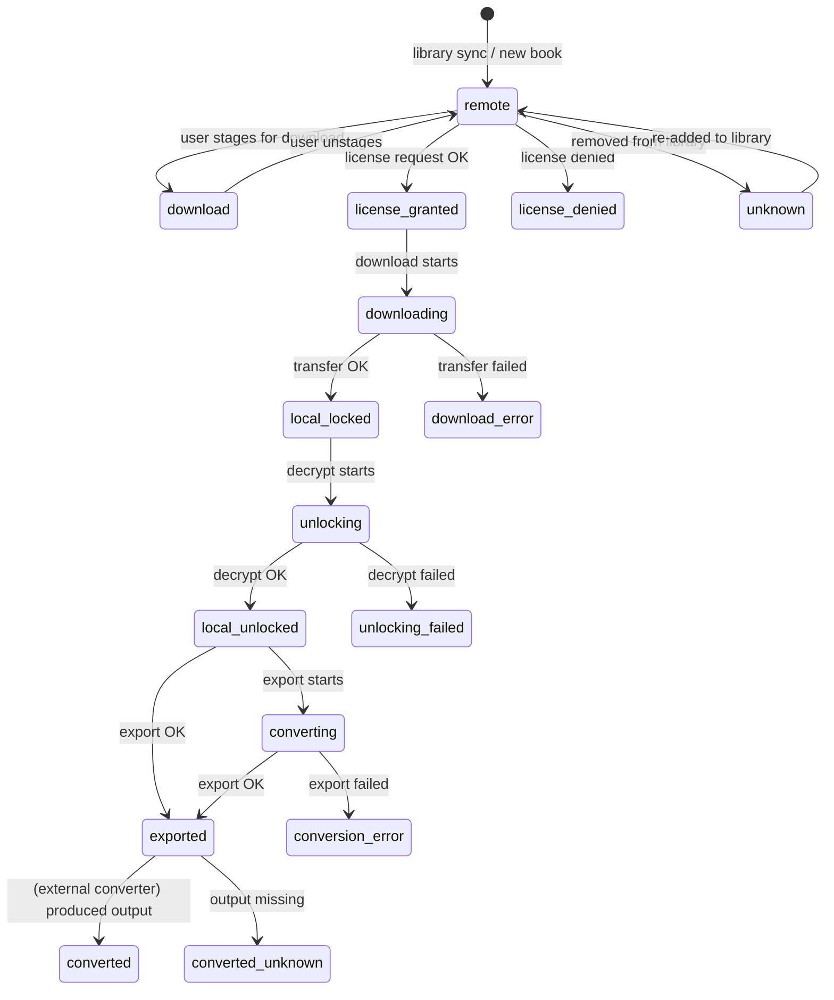

# Book Lib Connect — Software Design Document

| Field | Value |
|---|---|
| **Document** | `design.md` |
| **Product** | Book Lib Connect (BLC) — standalone Audible downloader and decrypter |
| **Repository** | `audiamus/BookLibConnect` |
| **Version documented** | 0.14.1 |
| **Target framework** | .NET 8 (`net8.0`, `net8.0-windows7.0`), x64 |
| **Status** | Living document — describes the implementation as of tag `v0.14.1` |
| **Audience** | Maintainers, contributors, reviewers, and anyone extending the codebase |

---

## Table of contents

1. [Purpose and scope](#1-purpose-and-scope)
2. [Legal and ethical stance](#2-legal-and-ethical-stance)
3. [System overview](#3-system-overview)
4. [Technology stack](#4-technology-stack)
5. [Solution and project map](#5-solution-and-project-map)
6. [Architectural layers](#6-architectural-layers)
7. [Domain model and persistence](#7-domain-model-and-persistence)
8. [Conversion state machine](#8-conversion-state-machine)
9. [Audible protocol specification](#9-audible-protocol-specification)
10. [Download, decrypt, export pipeline](#10-download-decrypt-export-pipeline)
11. [Concurrency and threading model](#11-concurrency-and-threading-model)
12. [Progress reporting model](#12-progress-reporting-model)
13. [File naming and on-disk layout](#13-file-naming-and-on-disk-layout)
14. [Configuration and settings](#14-configuration-and-settings)
15. [Security model](#15-security-model)
16. [Logging, diagnostics and supportability](#16-logging-diagnostics-and-supportability)
17. [Online update mechanism](#17-online-update-mechanism)
18. [User interface specification](#18-user-interface-specification)
19. [Error handling and resilience](#19-error-handling-and-resilience)
20. [Build, packaging and release](#20-build-packaging-and-release)
21. [Extension points and customization](#21-extension-points-and-customization)
22. [Known limitations and technical debt](#22-known-limitations-and-technical-debt)
23. [Testing strategy](#23-testing-strategy)
24. [Glossary](#24-glossary)
25. [Appendix A — Source file map](#25-appendix-a--source-file-map)
26. [Appendix B — Audible API endpoint reference](#26-appendix-b--audible-api-endpoint-reference)
27. [Appendix C — Change log of design-relevant decisions](#27-appendix-c--change-log-of-design-relevant-decisions)

---

## 1. Purpose and scope

### 1.1 What the product does

Book Lib Connect is a single-user, Windows desktop application that:

1. Signs a user in to their **own** Audible account using a standard web browser (the app never sees the user's password).
2. Registers itself as an *audible device* against that account, obtaining the same device-scoped credentials (bearer tokens, ADP token, device private key) that the official Audible mobile apps receive.
3. Lists the user's purchased library, lets the user select titles, and downloads them from Audible's CDN.
4. Removes the DRM using the **account- and book-specific keys returned by Audible for that user's own account**, and writes plain `.m4b` (M4A-in-MP4) files.
5. Optionally re-packages the result into the `.aax` + sidecar-JSON layout that the companion tool [AAX Audio Converter](https://github.com/audiamus/AaxAudioConverter) consumes.
6. Tracks per-title state (downloaded / decrypted / exported) persistently in a local SQLite database, so it can resume and reconcile against the filesystem on each start.

### 1.2 Explicit non-goals

The following are **out of scope by design** and are listed here so that future contributors do not accidentally introduce them:

- No DRM *cracking* or key *derivation from scratch*. Keys are always fetched from Audible's own license endpoint for the signed-in account.
- No credential harvesting, no password storage, no "cookie injection" tooling.
- No content sharing, seeding, library sharing, or any mass-distribution feature.
- No support for Amazon Prime "included with Prime" titles that Audible does not license for download.
- No cross-platform target. Windows is the only supported platform (WinForms + WMI hardware ID + Win32 file APIs + Inno Setup packaging).
- No multi-user / server / headless mode. The app is a single-user desktop tool.

### 1.3 Actors

| Actor | Description |
|---|---|
| **User** | The account holder. Operates the GUI, browses the library, picks titles. |
| **Browser** | Used only for the Amazon/Audible sign-in web page. The app never fills it in. |
| **Audible / Amazon APIs** | `api.amazon.<tld>` and `api.audible.<tld>` provide registration, token, library, catalog and license endpoints. |
| **Audible CDN** | Serves the encrypted `.aaxc` payload via a signed, short-lived `offline_url`. |
| **AAX Audio Converter** | Companion tool that consumes the optional `.aax` export. |
| **GitHub Releases** | Source of the self-update manifest (`res/Setup.json`) and setup binaries. |

---

## 2. Legal and ethical stance

This section is normative, not decorative. It mirrors the project's published notice and is repeated here so that the design intent is unambiguous.

- The application **does not crack DRM**. It performs the *same* key-provisioning handshake the official Audible client performs, then uses the account-scoped keys Audible issued for that specific account and book. This is the same "authorized personal archival" model used by the reference implementations the project acknowledges (mkb79/Audible, rmcrackan/AudibleApi, Mbucari/AAXClean).
- The application **never asks for, stores, or transmits the user's password.** Sign-in happens in the user's own browser.
- Output is for the user's **personal** archiving, conversion and convenience only.
- De-DRM'd files **must not** be uploaded to open servers, torrents, or any mass-distribution channel. No support is offered for such use.
- Consequently, the design avoids any feature whose only purpose would be redistribution: no "share library" URLs, no "upload" verbs in the UI or in `IAudibleApi`, no anonymised public indexes.

**Design consequence:** the API surface (`IAudibleApi`) is deliberately small and one-directional. Every method either reads the user's own library, fetches a license for a title the user owns, or moves bytes the user already owns.

---

## 3. System overview

### 3.1 Context diagram



### 3.2 End-to-end flow summary



---

## 4. Technology stack

| Concern | Choice | Rationale |
|---|---|---|
| Runtime | .NET 8 (LTS) | Current LTS at time of writing; required by the installer documentation. |
| UI framework | Windows Forms (`net8.0-windows7.0`) | Mature, no extra dependency; the product is a single-user desktop tool where deployment simplicity dominates. |
| Language | C# 12 (records, file-scoped namespaces, primary constructors on some types) | Modern, but the codebase deliberately keeps a conservative style (`this.`-prefixed calls, explicit braces). |
| Persistence | EF Core 9.0.21 + SQLite (`Microsoft.EntityFrameworkCore.Sqlite`, `.Proxies`, `.Tools`) | Relational modelling fits the library graph; SQLite gives a single-file, zero-admin DB. Lazy-loading proxies allow the graph to be navigated without manual `Include`s everywhere. |
| DRM removal | **AAXClean 3.1.0** (NuGet, by Mbucari) | In-process decryption; no FFmpeg/child-process dependency. |
| HTML post-processing | **HtmlAgilityPack 1.13.1** | Turns the publisher summary HTML into plain text for the details pane. |
| Imaging | **System.Drawing.Common 10.0.13** | Cover art and state icons. |
| Hardware identity | **System.Management 10.0.13** | WMI queries for CPU + motherboard serial used in config-encryption key derivation. |
| Packaging | **Inno Setup 6** | Produces `BookLibConnect-<ver>-Setup.exe`; x64-only, modern wizard. |
| Publish | `dotnet publish` single-file, `win-x64`, framework-dependent | `FolderProfile.pubxml`; `PublishSingleFile=true`, `SelfContained=false`. |

Third-party runtime dependencies at the app level are therefore: **AAXClean**, **HtmlAgilityPack**, **System.Drawing.Common**, plus the EF Core stack, plus `System.Management`.

---

## 5. Solution and project map

The solution file is `src/AaxAudioConverter 2.x.sln` (historical name retained from the sibling product). It contains **14 projects** plus one Inno Setup solution item and three solution folders (`app`, `BookLibConnect`, `global`).

### 5.1 Project inventory

| Project | Assembly | TFM | Root namespace | Responsibility |
|---|---|---|---|---|
| `Connect.app.gui.core` | `BookLibConnect` | `net8.0-windows7.0` | `core.audiamus.connect.app.gui` | **Executable.** `Program`, `MainForm`, first-run wizard steps, `WaitForm`, `AboutForm`, app/user settings, progress processors. |
| `Connect.ui.lib.core` | `audiamus.connect.ui.core` | `net8.0-windows7.0` | `core.audiamus.connect.ui` | Reusable WinForms controls: library window, download grid, data sources, property-grid adapters, profile dialogs. |
| `Connect.lib.core` | `audiamus.connect.core` | `net8.0` | `core.audiamus.connect` | **Domain core.** Audible client, authorization, API access, book library, download/decrypt job, AAX exporter. |
| `BooksDatabase.core` | `audiamus.booksdb.core` | `net8.0` | `core.audiamus.booksdb` | EF Core entities, `BookDbContext`, migrations, quality/codec helpers. |
| `Audible.json.core` | `audiamus.audiible.json.core` | `net8.0` | `core.audiamus.adb.json` | DTOs for Audible JSON payloads + `Serialization<T>` helpers. |
| `CommonTypes.lib.core` | `audiamus.common.types.core` | `net8.0` | `core.audiamus.common` | `ERegion`, `IBookMeta`, `IAudioQuality`. |
| `CommonUtil.lib.core` | `audiamus.common.util.core` | `net8.0` | `core.audiamus.util` | `ProgressMessage`, thread-progress helpers, `FileEx` (unbuffered copy), `OnlineUpdate`, log/tmp maintenance, update settings. |
| `AuxLib.core` | `audiamus.aux.core` | `net8.0` | `core.audiamus.aux` | Cross-cutting primitives: `Logging`, `ApplEnv`, `SettingsManager`, `AffineSynchronizationContext`, `ResourceGuard`, `LogGuard`, `SymmetricEncryptor`, CRC32, string/date/UNC helpers. |
| `AuxWin.lib.core` | `audiamus.aux.win.core` | `net8.0-windows7.0` | `core.audiamus.aux.win` | WinForms helpers: `SimpleWizard`, `InteractionCallbackHandler`, `SortableBindingList(Suspensible)`, `SystemMenu`. |
| `AuxWin.DialogBox.core` | `audiamus.aux.win.dialogbox.core` | `net8.0-windows7.0` | `core.audiamus.aux.win` | Task-dialog / message-box plumbing via Win32 subclassing. |
| `AuxWin32Lib.core` | `audiamus.aux.w32.core` | `net8.0` | `core.audiamus.aux.w32` | Win32 file I/O (`WinFileIO`), file association helpers. |
| `PropGridLib.core` | `audiamus.aux.propgrid.core` | `net8.0-windows7.0` | `core.audiamus.aux.propgrid` | Enhanced `PropertyGrid` adapters, descriptors, dynamic properties, property sorting. |
| `SystemMgmt.core` | `audiamus.sysmgmt.core` | `net8.0` | `core.audiamus.sysmgmt` | WMI hardware identity: CPU id, disk id, motherboard serial. |
| `TreeDecomposition.core` | `audiamus.aux.treedecomp.core` | `net8.0` | `core.core.audiamus.aux.diagn` | Object-graph pretty printer used for settings dump / diagnostics. |

### 5.2 Dependency graph



**Layering rules encoded by the graph:**

- `net8.0` (platform-agnostic) projects never reference `net8.0-windows7.0` projects. `Connect.lib.core` — the heart of the product — is UI-free and platform-free.
- The only project that references both the domain core and the WinForms layer is the executable `Connect.app.gui.core`.
- `BooksDatabase.core` depends on `PropGridLib.core` only for `BasePropertyGridAdapter` support used by entity metadata helpers; it does **not** depend on the UI layer.

---

## 6. Architectural layers

### 6.1 Layer summary

| # | Layer | Projects | Rule |
|---|---|---|---|
| L0 | **Foundation** | `AuxLib.core`, `AuxWin32Lib.core`, `SystemMgmt.core`, `TreeDecomposition.core` | No product knowledge. Pure utilities. |
| L1 | **Shared contracts** | `CommonTypes.lib.core`, `Audible.json.core`, `CommonUtil.lib.core` | Types and DTOs shared across layers. |
| L2 | **Persistence** | `BooksDatabase.core` | Entities + `DbContext` + migrations. Knows nothing about HTTP or UI. |
| L3 | **Domain / application** | `Connect.lib.core` | All Audible protocol logic, orchestration, export. Depends only on L0–L2. |
| L4 | **Presentation** | `Connect.ui.lib.core`, `AuxWin.lib.core`, `AuxWin.DialogBox.core`, `PropGridLib.core` | Controls, dialogs, data binding. Depends on L3 via interfaces only. |
| L5 | **Composition root** | `Connect.app.gui.core` | Wiring, settings, startup sequence, progress rendering. |

### 6.2 Layer 3 — `Connect.lib.core` in detail

This is where the real design lives. The types and their responsibilities:

| Type | Kind | Responsibility |
|---|---|---|
| `AudibleClient` | public class | **Facade / composition entry point for the domain.** Owns the `BookLibrary`, the `Authorize` service and the currently selected profile (`ProfileBundle`). Exposes `Api` (lazily constructed `IAudibleApi`), profile add/remove/change, account alias management. |
| `AudibleApi` | internal class, implements `IAudibleApi` | **The protocol client.** All HTTP to Audible: library listing, catalog lookup, license acquisition, payload download, decryption, cover images. |
| `Authorize` | internal class | Device registration, token refresh, config read/write, token-derived config encryption key. |
| `AudibleLogin` | internal class | Builds the Amazon/Audible sign-in URL (OpenID Connect 2.0 + PKCE), derives device serial / client id, parses the redirected response URL into an `Authorization`. |
| `Profile`, `TokenBearer`, `DeviceInfo`, `CustomerInfo`, `Authorization`, `Configuration` | internal records/classes | The **persisted credential model**. `Configuration` is the JSON-serialized (optionally encrypted) container of all profiles. |
| `BookLibrary` | internal class, implements `IBookLibrary` | **The repository.** Maps Audible JSON products into the EF entity graph; caches books per profile; reconciles on-disk files against persisted state; stores licenses, chapters, and persistent conversion state. |
| `DownloadDecryptJob<T>` | public generic class | **The pipeline orchestrator.** Drives license → download → decrypt → convert for a set of conversions, with throttling, progress and cancellation. |
| `AaxExporter` | public class | **The export stage.** Copies the decrypted file to the export directory as `.aax` and writes the sidecar JSON metadata files that AAX Audio Converter expects. |
| `Localization` / `Locale` | static | Region → domain / marketplace-id mapping table. |
| `Anonymizer` | static | Replaces usernames/passwords in log output with stable pseudonyms (`¿ACCNT1¿`). |
| `HttpClientEx` | internal | `HttpClient` with an explicit `CookieContainer`, auto-redirect **disabled**, gzip/deflate decompression enabled. |

### 6.3 Layer 4 — `Connect.ui.lib.core` in detail

| Type | Responsibility |
|---|---|
| `BookLibForm` | The library window (`Library for "<alias>" and region "<region>"`). Hosts `BookLibDGVControl` in a split container; lower pane shows a property grid (metadata), publisher summary text box, and cover image. Runs the file-vs-state reconciliation on load. |
| `BookLibDGVControl` | The library `DataGridView`. Owns the "download selection" (books staged for download), the resync button, and the `BookDownloadSelectionChanged` event. |
| `ConvertDGVControl` | The download queue grid on `MainForm`. Owns the list of staged `Conversion`s, the `Download…`/`Remove` buttons, and the `IdleChanged` / `SelectionChanged` events consumed by `MainForm`. |
| `BookDataSource`, `ConversionDataSource`, `BookDataSourceBase`, `DataSourceBase<T>` | Data-binding wrappers. Expose computed/display-friendly properties (state icon, formatted duration, size in MB, year, series, genre) to the grid while keeping the entity untouched. |
| `BookPGA` | Property-grid adapter for a single book (read-only metadata view). |
| `ManageProfilesForm`, `NewProfileForm`, `AccountAliasForm` | Profile management: list/rename/remove registered devices; create a new device registration; assign a human-readable alias to an account. |
| `DataGridViewEx` | Custom `DataGridView` that preserves scroll position and horizontal offset across sorts, and exposes `BeginSorting`/`EndSorting` events. |
| `SortableBindingListSuspensible<T>` | Sortable binding list that can be **suspended** — additions/removals are queued and applied in bulk, avoiding UI churn during large library updates. |

### 6.4 Layer 5 — `Connect.app.gui.core` in detail

| Type | Responsibility |
|---|---|
| `Program` | Entry point. Sets `HighDpiMode.PerMonitorV2`, enables visual styles, forces `InvariantCulture` (so decimal separators in file names are stable), configures the log level from `appsettings.json` or the `--Log <n>` command-line switch, then runs `MainForm`. |
| `MainForm` | The shell. Top panel = settings group boxes (Profiles / Download settings / Export settings). Centre = `ConvertDGVControl`. Bottom = three progress bars (Download / Decrypt / Export) plus `Run` and `Abort`. |
| `WizStepProfile`, `WizStepDownload`, `WizStepExport`, `WizStepHelp` | First-run wizard pages, hosted in `SimpleWizard`. |
| `WaitForm` | Small modal progress form shown during startup while the DB migrates and the library syncs; its label is updated with task text. |
| `ProgressProcessor1` / `ProgressProcessor2` | Translate the abstract `ProgressMessage` stream into WinForms `ProgressBar` updates (see §12). |
| `UserSettings` / `AppSettings` | Typed settings containers persisted as JSON (`usersettings.json` / `appsettings.json`). |

---

## 7. Domain model and persistence

### 7.1 Entity relationship diagram

```mermaid
erDiagram
    ACCOUNT ||--o{ CONVERSION : "owns (AccountId+Region)"
    BOOK ||--|| CONVERSION : "has (BookId)"
    BOOK ||--o{ COMPONENT : "has parts"
    COMPONENT ||--|| CONVERSION : "has (ComponentId)"
    BOOK ||--o{ CHAPTERINFO : "has"
    COMPONENT ||--o{ CHAPTERINFO : "has"
    CHAPTERINFO ||--o{ CHAPTER : "contains"
    CHAPTER ||--o{ CHAPTER : "nested sub-chapters"
    BOOK ||--o{ SERIESBOOK : "in"
    SERIES ||--o{ SERIESBOOK : "lists"
    BOOK }o--o{ AUTHOR : "written by"
    BOOK }o--o{ NARRATOR : "narrated by"
    BOOK }o--o{ GENRE : "tagged"
    GENRE ||--o{ LADDER : "step in"
    LADDER ||--o{ RUNG : "contains"
    RUNG }o--|| GENRE : "points at"
    BOOK }o--o{ CODEC : "available in"
    BOOK }o--o{ LADDER : "classified by"

    ACCOUNT {
        int Id PK
        string Alias
        string AudibleId "customer account id"
    }
    BOOK {
        int Id PK
        string Asin UK
        string Title
        string Subtitle
        string PublisherName
        string PublisherSummary
        string MerchandisingSummary
        float AverageRating
        int RunTimeLengthSeconds
        long FileSizeBytes
        int SampleRate
        int BitRate
        int DownloadQuality "EDownloadQuality? (INTEGER)"
        int FileCodec "ECodec? (INTEGER)"
        int DeliveryType "EDeliveryType? (INTEGER)"
        bool Unabridged
        bool AdultProduct
        datetime PurchaseDate
        datetime ReleaseDate
        string Language
        string CoverImageUrl
        string CoverImageFile
        string Sku
        string SkuLite
        string LicenseKey
        string LicenseIv
        bool Deleted
    }
    COMPONENT {
        int Id PK
        string Asin UK
        string Title
        int PartNumber
        int RunTimeLengthSeconds
        long FileSizeBytes
        int DownloadQuality "EDownloadQuality? (INTEGER)"
        int FileCodec "ECodec? (INTEGER)"
        string LicenseKey
        string LicenseIv
        int BookId FK
    }
    CONVERSION {
        int Id PK
        int State "EConversionState (INTEGER)"
        datetime LastUpdate
        string DownloadFileName
        string DestDirectory
        int AccountId
        int Region "ERegion (INTEGER)"
        int BookId FK
        int ComponentId FK
    }
    CHAPTERINFO {
        int Id PK
        int BrandIntroDurationMs
        int BrandOutroDurationMs
        int RuntimeLengthMs
        bool IsAccurate
        int BookId FK
        int ComponentId FK
    }
    CHAPTER {
        int Id PK
        int LengthMs
        int StartOffsetMs
        string Title
        int ChapterInfoId FK
        int ParentChapterId FK
    }
    SERIES {
        int Id PK
        string Asin UK
        string Title
    }
    SERIESBOOK {
        int SeriesId PK,FK
        int BookId PK,FK
        int BookNumber
        int SubNumber
        string Sequence
        int Sort
    }
    AUTHOR { int Id PK; string Asin UK; string Name }
    NARRATOR { int Id PK; string Asin UK; string Name }
    GENRE { int Id PK; long ExternalId UK; string Name }
    LADDER { int Id PK }
    RUNG { int OrderIdx PK,FK; int GenreId FK }
    CODEC { int Id PK; string Name }
```

### 7.2 Key modelling decisions

**`Book` vs `Component` vs `Conversion`.** These three are the crux of the model:

- A **`Book`** is what Audible sells. It has marketing metadata (title, summary, rating, cover) and a delivery type.
- A **`Component`** is a *physical part* of a multi-part book (`relationship_type == "component"`, `relationship_to_product == "child"`). Components inherit most metadata from their parent book via `[NotMapped]` pass-throughs (`Author`, `Narrator`, `ReleaseDate`, `PurchaseDate`).
- A **`Conversion`** is a *download+decrypt+export unit of work*. **Every** book has exactly one conversion (the "whole book" variant), and **every** component has exactly one conversion (the "part N" variant). A single-part book therefore has exactly one conversion.

  This model is what lets the UI show a flat list of rows in the download grid that mixes "whole book" rows and "part N" rows, and lets one code path (`DownloadDecryptJob`) treat both identically.

**`Conversion.AccountId` + `Conversion.Region` are the tenancy key.** The same book can exist for several accounts/regions. The composite `(AccountId, Region)` scopes every library query, every state reconciliation and every book-cache entry.

> **Important subtlety:** `Conversion.AccountId` holds the **local** `Account.Id` (an `int` primary key of the `Account` table), *not* Audible's `customer_info.user_id`. The mapping from Audible's account id to the local row lives in the `Account` table (`Account.AudibleId` → `Account.Id`). `AudibleApi.ensureAccountId()` resolves the Audible account id to the local id via `BookLibrary.GetAccountId(...)` → `AccountAliasContext.LocalId`, and from then on `ProfileId(int AccountId, ERegion Region)` always carries the *local* id. The `Account` table is therefore the indirection that lets one Audible account have a friendly alias while the DB keys stay numeric.

**`Book.Deleted` is a soft-delete flag.** When a resync shows a title is no longer in the account's library, the book is flagged `Deleted` and its conversion state is rolled back to `unknown` — but the row, the file and the history stay, so that a later re-add can flip it back (`readd()` in `BookLibrary`). Files are never deleted by the app.

**`Book.LicenseKey` / `Book.LicenseIv` are stored per (book|component).** They are the account-scoped decryption key/IV obtained from the license endpoint. They live in the local DB and are required to decrypt an already-downloaded `.aaxc` in a later session.

**`Chapter` is self-referential.** Audible's `chapter_info.chapters[]` is a tree (chapters containing sub-chapters). `Chapter.ParentChapterId` + `Chapter.ChapterInfoId` model both levels; `ChapterInfo` carries brand intro/outro durations and runtime.

**`SeriesBook` has a composite key** `(SeriesId, BookId)` and stores three independent orderings: the raw `Sequence` string, a parsed `BookNumber`/`SubNumber` pair (from a regex `(\d+)(\.(\d+))?`), and an optional integer `Sort`. The exporter picks the best available ordering at export time.

**`Author` / `Narrator` have unique `Asin` but some lack one.** When Audible omits an ASIN for a person, `BookDbContext.GetNextPseudoAsin` allocates a synthetic 7-digit id from the `PseudoAsins` table, keeping the unique index satisfiable. `cleanupDuplicateAuthors()` then merges author rows that share a name, preferring the one with a real (long) ASIN.

**`Account` maps Audible account ids to user-chosen aliases.** Aliases are what the UI shows instead of raw account ids. Uniqueness is enforced in the UI by comparing CRC32 checksums of existing aliases (`AccountAliasContext.Hashes`).

### 7.3 Database configuration

- **Provider:** SQLite via `UseSqlite($"Data Source={DbPath}")`.
- **Default path:** `%LOCALAPPDATA%\<Company>\<AppName>\data\audiobooks.db` (see `ApplEnv`; in practice `%LOCALAPPDATA%\audiamus\BookLibConnect\data\audiobooks.db`).
- **Context variants:**
  - `BookDbContext` — plain, no proxies. Used for write paths where the whole graph is already materialised.
  - `BookDbContextLazyLoad` — adds `UseLazyLoadingProxies()`. Used for read paths and for the incremental library update, where navigating `book.Components[].Conversion` should not require an explicit `Include`.
- **Startup (`BookDbContext.StartupAsync`)**: check pending migrations → back up the previous DB file (named `<stub> <lastAppliedMigration><ext>`) → `MigrateAsync()` → `VACUUM` to reclaim space → `CanConnect()` sanity check.
- **Migration history** (all in `BooksDatabase.core/Migrations`):

  | Migration | Purpose |
  |---|---|
  | `20220107145340_InitialCreate` | Base schema. |
  | `20220119172449_SeriesSeq` | Series ordering columns. |
  | `20220122181409_ChapterTree` | Nested chapter support. |
  | `20220210175323_NullableDeleted` | `Deleted` made nullable. |
  | `20220219161122_DownloadQuality` | Per-item download-quality tracking. |

### 7.4 Book library reconciliation

`BookLibrary.CheckUpdateFilesAndState` is the mechanism that keeps the UI honest. On every library window open it walks every conversion of the active profile and asks: *does the file the DB claims still exist?*

| Persisted state | File checked | Fallback chain | Flags |
|---|---|---|---|
| `local_locked` | `.aaxc` | → `remote` | `deleteIfMissing`, `relocatable` |
| `local_unlocked` | `.m4b` | → `.aaxc` → `remote` | `relocatable` |
| `exported` | `.aax` (export dir) | → `.m4b`/`.aaxc` (download dir) → `converted_unknown` | none (not relocatable) |
| `converted` | any `.m3u/.mp3/.m4a/.m4b` in dest dir | → local chain → `converted_unknown` | — |

`relocatable` means the file may have been moved by the user: the checker also looks for `<downloadDir>/<basename><ext>` and, if found, rewrites `Conversion.DownloadFileName` to that path. `deleteIfMissing` clears the stored filename when the encrypted payload has vanished.

The result is a set of conversions whose state has changed; those are pushed to the UI through an `Action<IConversion>` callback and, if the user confirms the prompt, persisted with `SaveChanges()`.

---

## 8. Conversion state machine

`EConversionState` (in `BooksDatabase.core/enums.cs`) is the central vocabulary of the product. Its **ordinal order is semantically meaningful** — several code paths compare with `<` / `>` against `local_locked`.

| # | State | Icon | Meaning |
|---|---|---|---|
| 0 | `unknown` | globe (struck) | Not in the account's library anymore / file gone. |
| 1 | `remote` | globe | Owned by the account; nothing local yet. |
| 2 | `download` | globe + arrow | Book is *staged* for download (transient UI state). |
| 3 | `license_granted` | key | License obtained; key/IV and download URL known. |
| 4 | `license_denied` | key (struck) | Audible refused the license. |
| 5 | `downloading` | down arrow | Payload transfer in flight. |
| 6 | `download_error` | down arrow (struck) | Transfer failed. |
| 7 | `local_locked` | closed lock | Encrypted `.aaxc` is on disk. |
| 8 | `unlocking` | key over lock | Decryption in flight. |
| 9 | `unlocking_failed` | key over lock (struck) | Decryption failed. |
| 10 | `local_unlocked` | open lock | Decrypted `.m4b` is on disk. |
| 11 | `exported` | mauve check | `.aax` + sidecar JSON written to the export folder. |
| 12 | `converting` | right arrow | Export in flight. |
| 13 | `converted` | green check | Fully exported / converted. |
| 14 | `converted_unknown` | grey check | Exported artefact missing from disk. |
| 15 | `conversion_error` | right arrow (struck) | Export failed. |



**Transient vs persistent state.** `Conversion.State` is the live in-memory state; `Conversion.PersistState` (a `[NotMapped]` field) remembers the state that was in force *before* the transient `download` state was applied. `ApplicableState()` resolves this:

```csharp
public static EConversionState ApplicableState (this Conversion conv) {
  if (conv.State == EConversionState.download && conv.PersistState.HasValue)
    return conv.PersistState.Value;
  else
    return conv.State;
}
```

The grid therefore shows the *real* state even while an item is staged for download.

**Multi-part aggregation.** For a multi-part book, the book's effective state is the **minimum** of its components' states (`Book.ApplicableState(multipart)`), so a partially downloaded set shows as the least-advanced state. The same aggregation is used for `ApplicableDownloadQuality` (the *minimum* quality across components, because a title is only as good as its weakest part).

**Quality upgrade semantics.** `DownloadDecryptJob` compares the requested quality against `book.ApplicableDownloadQuality(...)`. If the user asks for a **higher** quality than what is on disk, both the download and decrypt steps are forced, regardless of the persisted state.

---

## 9. Audible protocol specification

This section documents the wire protocol as implemented in `Connect.lib.core`. It is the highest-risk area of the codebase: the server-side contract can change without notice.

### 9.1 Endpoints and hosts

Two hosts are used, both derived from the region's TLD (`Locale.FromCountryCode`):

| Host | Used for |
|---|---|
| `https://api.amazon.<tld>` | Registration, token refresh, user profile, catalog, license requests, cover images. |
| `https://api.audible.<tld>` | Library listing, and the CDN payload download. |

Region → TLD / marketplace-id table (`Localization.cs`):

| Region | TLD | Marketplace id |
|---|---|---|
| `de` | `de` | `AN7V1F1VY261K` |
| `us` | `com` | `AF2M0KC94RCEA` |
| `uk` | `co.uk` | `A2I9A3Q2GNFNGQ` |
| `fr` | `fr` | `A2728XDNODOQ8T` |
| `ca` | `ca` | `A2CQZ5RBY40XE` |
| `it` | `it` | `A2N7FU2W2BU2ZC` |
| `au` | `com.au` | `AN7EY7DTAW63G` |
| `in` | `in` | `AJO3FBRUE6J4S` |
| `jp` | `co.jp` | `A1QAP3MOU4173J` |
| `es` | `es` | `ALMIKO4SZCSAR` |
| `br` | `com.br` | `A10J1VAYUDTYRN` |

### 9.2 Registration (device sign-up)

**Step 1 — Build the sign-in URL** (`AudibleLogin.BuildAuthUri`):

- A 40-character random alphanumeric **device serial** is generated with `RandomNumberGenerator` (`A–Z a–z 0–9`). *A GUID was used previously but was replaced because it triggered Audible throttling — see issue #211.*
- The **client id** is the hex encoding of `"<serial>#A2CZJZGLK2JJVM"` where `A2CZJZGLK2JJVM` is the iOS device type.
- A **PKCE** pair is generated: 32 random bytes → URL-safe Base64 code verifier; code challenge = `BASE64URL(SHA256(verifier))`, method `S256`.
- The target host is `www.amazon.<tld>` for a normal Amazon account, or `www.audible.<tld>` when the *pre-Amazon* (legacy Audible) username path is used (only allowed for `de`, `uk`, `us`).
- Query parameters include the OpenID Connect 2.0 set: `openid.oa2.response_type=code`, `openid.oa2.code_challenge`, `openid.oa2.client_id=device:<clientId>`, `openid.oa2.scope=device_auth_access`, `openid.return_to`, `openid.assoc_handle=amzn_audible_ios_<cc>`, `pageId=amzn_audible_ios`, `marketPlaceId`, and `openid.identity`/`openid.claimed_id` set to the standard identifier-select URL.

**Step 2 — User signs in in the browser.** The app opens the URL (`ShellExecute`) and the user copies the *final* URL out of the address bar back into the app (`NewProfileForm.textBox2`).

**Step 3 — Parse the redirect** (`Authorization.Create`): the query parameter `openid.oa2.authorization_code` carries the authorization code. The PKCE verifier is attached to the resulting `Profile`.

**Step 4 — Register the device** (`Authorize.RegisterAsync` → `POST /auth/register`):

```jsonc
{
  "requested_token_type": ["bearer", "mac_dms", "website_cookies", "store_authentication_cookie"],
  "cookies": { "website_cookies": [], "domain": ".amazon.<tld>" },
  "registration_data": {
    "domain": "Device",
    "app_version": "4.60",
    "device_serial": "<40-char serial>",
    "device_type": "A2CZJZGLK2JJVM",
    "device_name": "%FIRST_NAME%%FIRST_NAME_POSSESSIVE_STRING%%DUPE_STRATEGY_1ST%Audible for iPhone",
    "os_version": "26.2",
    "software_version": "46000856",
    "device_model": "iPhone",
    "app_name": "Audible"
  },
  "auth_data": {
    "client_id": "<hex client id>",
    "authorization_code": "<code>",
    "code_verifier": "<pkce verifier>",
    "code_algorithm": "SHA-256",
    "client_domain": "DeviceLegacy"
  },
  "requested_extensions": ["device_info", "customer_info"]
}
```

> The `app_version` / `os_version` / `software_version` constants are deliberately *higher* than the real iOS app's, as a mitigation for server-side throttling of the registration endpoint.

**Step 5 — Consume the registration response** (`Authorize.updateProfile`). The response carries four credential groups:

| Group | Extracted | Stored in |
|---|---|---|
| `success.extensions.device_info` | device name/type/serial | `Profile.DeviceInfo` |
| `success.extensions.customer_info` | customer name, user id | `Profile.CustomerInfo` |
| `success.tokens.bearer` | access token, refresh token, `expires_in` | `Profile.Token` |
| `success.tokens.mac_dms` | `device_private_key` (PEM), `adp_token` | `Profile.PrivateKey`, `Profile.AdpToken` |
| `success.tokens.website_cookies` | cookie name/value pairs | `Profile.Cookies` |
| `success.tokens.store_authentication_cookie` | cookie | `Profile.StoreAuthentCookie` |

### 9.3 Token refresh

`POST /auth/token`, form-encoded:

```
app_name=Audible
app_version=4.60
source_token=<refresh token>
requested_token_type=access_token
source_token_type=refresh_token
```

plus header `x-amzn-identity-auth-domain: api.amazon.<tld>`.

The response's `access_token` and `expires_in` are applied to the profile. Refresh is skipped if the token is still valid for more than 5 minutes.

### 9.4 Request signing (ADP)

Signed requests carry three headers:

| Header | Value |
|---|---|
| `x-adp-token` | the account's ADP token |
| `x-adp-alg` | `SHA256withRSA:1.0` |
| `x-adp-signature` | `<base64(RSA-SHA256 signature)>:<xml-time>` |

The signed data string is:

```
<METHOD>\n<relative URL>\n<time>\n<request body or empty>\n<ADP token>
```

- `time` = `DateTime.UtcNow` **rounded down to 10-minute boundaries** and formatted with `XmlConvert.ToString(..., Utc)` — this is the server's timestamp-window tolerance.
- The signature is `RSA.SignHash(SHA256(dataString), SHA256, Pkcs1)` using the device private key imported from PEM via `RSA.ImportFromPem`.

> **Note:** `signRequestAsync` is declared `async` but performs no `await`; the signature is computed synchronously. This is a vestige of an earlier implementation and is listed in §22.

### 9.5 Library listing

`GET /1.0/library` with query parameters:

- `purchased_after` — an XML timestamp. For an incremental sync this is the newest `PurchaseDate` in the DB for this `(AccountId, Region)` **plus 1 ms**; for a full resync it is the Unix epoch.
- `num_results=100` — page size.
- `page` — 1-based page index.
- `response_groups=` — a fixed, comma-separated list requesting badge types, category ladders, claim code URL, contributors, download flags, media, origin ASIN, PDF URL, percent complete, price, product attributes, product description, extended attributes, plan details, plans, review attributes, reviews, sample, series and SKU.

Pages are fetched until a page yields no items. The products are then de-duplicated by ASIN, sorted by `purchase_date`, and handed to `BookLibrary.AddRemBooksAsync`.

### 9.6 Catalog lookup

`GET /1.0/catalog/products/{asin}?response_groups=contributors,media,product_attrs,...` — used to back-fill metadata (notably component runtime) that the library listing does not carry.

### 9.7 License acquisition and DRM key handling

`POST /1.0/content/{asin}/licenserequest`:

```json
{
  "consumption_type": "Download",
  "supported_drm_types": ["Adrm", "Mpeg"],
  "quality": "<Low|Normal|High|Extreme>",
  "response_groups": "last_position_heard,pdf_url,content_reference,chapter_info"
}
```

The response is a `LicenseResponse` containing `content_license`:

| Field | Use |
|---|---|
| `status_code` | `Granted` / `Denied`. Non-granted ⇒ `license_denied`, and `license_denial_reasons[]` is logged. |
| `license_response` | Base64 blob that must be decrypted to obtain the voucher. |
| `content_metadata.content_url.offline_url` | The signed CDN URL of the encrypted payload. |
| `content_metadata.content_reference.content_size_in_bytes` | Expected payload size (used to validate the download). |
| `content_metadata.content_reference.content_format` | Codec (e.g. `aax_44_64`) → bit rate / sample rate. |
| `content_metadata.chapter_info` | Chapter tree, brand intro/outro, runtime. |

**Voucher decryption** (`AudibleApi.decryptLicense`) — this is the core cryptographic step:

```
hashable = deviceInfo.type + deviceInfo.serial + customerInfo.accountId + license.asin
hash     = SHA256(ASCII(hashable))
key      = hash[0..16]
iv       = hash[16..32]
plain    = AES-256-CBC(decrypt, key=key, iv=iv, padding=None) over Base64Decode(license_response)
voucher  = JSON.parse(ASCII(plain up to first 0x00 byte))
```

`voucher.key` and `voucher.iv` are then stored on the book/component entity and are what `AAXClean` needs.

**Filename derivation** happens in the same transaction (`BookLibrary.setDownloadFilenameAndCodec`):

```
<title pruned, truncated to 20 chars>_<ASIN>_LC[_<bitrate>][_<samplerate>]
```

Example: `Pride and Prejudice_B00…_LC_64_22050`.

### 9.8 Payload download

`GET <offline_url>` with `User-Agent: Audible/671 CFNetwork/1240.0.4 Darwin/20.6.0`, using `HttpCompletionOption.ResponseHeadersRead` so the body streams rather than buffering. The stream is copied through two `BufferedStream`s (16 KiB buffer) into `<DownloadFileName>.aaxc`. Progress is reported as absolute bytes; success is `bytesWritten >= content_size_in_bytes`.

### 9.9 Decryption

`AAXClean.AaxFile` opens the `.aaxc`, `SetDecryptionKey(key, iv)`, then `ConvertToMp4aAsync(outputStream)` produces the `.m4b`. The library exposes `AudioChannels`; after a successful conversion the files are renamed with a `_Mono` / `_Stereo` suffix and the suffix is persisted in `Conversion.DownloadFileName`.

Cancellation is wired through `Mp4Operation.ConversionProgressUpdate` → `mp4Operation.CancelAsync()`.

---

## 10. Download, decrypt, export pipeline

### 10.1 Orchestration

`DownloadDecryptJob<T>` where `T : ICancellation` is the pipeline driver. It is generic over the context type so the core library has no dependency on the GUI's `ConversionContext`.

```
DownloadDecryptAndConvertAsync(conversions, progress, context, convertAction)
│
├─ progress.Report(itemCount = N)
├─ for each conversion (sequentially):
│   ├─ if cancelled → return
│   ├─ progress.Report(incItem = 1)
│   └─ getLicenseAndDownloadAsync(conv)
│        ├─ persisted state = Api.GetPersistentState(conv)
│        ├─ hasLockedFile   = File.Exists(name + ".aaxc")
│        ├─ hasUnlockedFile = File.Exists(name + ".m4b")
│        ├─ doDownload = state < local_locked  || !hasLockedFile
│        ├─ doDecrypt  = state < local_unlocked || !hasUnlockedFile
│        ├─ if requestedQuality > previousQuality → doDownload = doDecrypt = true
│        ├─ if (doDownload && doDecrypt):
│        │     conv.DownloadFileName = settings.DownloadDirectory
│        │     Api.GetDownloadLicenseAndSaveAsync(conv, quality)
│        │     Api.DownloadAsync(conv, onProgressSize, token)
│        │  else: Api.RestorePersistentState(conv)
│        └─ if success → Task.Run(decryptAsync(conv))   ← parallelised
│
└─ while any running task incomplete: await Task.WhenAll(...)
```

**Licensing and downloading are sequential per book; decryption is parallelised.** Downloads are I/O-bound and each needs its own license round-trip; decryption is CPU-bound and is throttled.

### 10.2 Throttling

`private static int MaxDecrypts => 1;` — a `Semaphore(1,1)` guards decryption, so exactly **one** decryption runs at a time regardless of core count. (The commented-out alternative was `Environment.ProcessorCount / 2`.) Downloads, by contrast, are not throttled beyond the natural serialisation of the license step.

### 10.3 Export stage

`AaxExporter.Export(book, context, onNewStateCallback)` is invoked through the `ConvertDelegate<T>` callback once *all* parts of a book are unlocked. It branches:

- **Single part** (no components, or multipart download disabled): export the book conversion.
- **Multi part:** export each component conversion in turn; the series sidecar is written only once (for the first part) to avoid duplicates.

For each item it:

1. Sets state `converting`.
2. Copies `<name>.m4b` → `<exportDir>\<name>.aax` using `FileEx.Copy` (10 MB unbuffered block copy with cancellation and per-mille progress). The copy is serialised by a static lock, because the same source/destination pairs can be produced concurrently for different parts.
3. Writes `content_metadata_<ASIN>.json` — the chapter tree, runtimes, brand intro/outro.
4. Writes `<ASIN>.json` — a compact product record (asin, title, sku, authors, series, runtime, flags).
5. Writes `series_titles_<SERIES_ASIN>.json` — the ordered list of books in each series the book belongs to (ordering preference: `Sort` → `BookNumber`/`SubNumber` → `Sequence`).
6. Sets state `exported`.

**Chapter de-duplication.** When exporting a multi-part book, the first chapter of each subsequent part is frequently a repeat of the brand intro. `AaxExporter.skipChapter` drops a leading chapter if a chapter with the same title and a length within 1500 ms (and shorter than 25 s) already appeared in a previous part. `AccuChapters` accumulates the chapter lists across parts to make this comparison possible.

### 10.4 File retention

`IDownloadSettings.KeepEncryptedFiles` controls whether the `.aaxc` is deleted after successful decryption. When false (default), the encrypted payload is removed to reclaim disk space.

---

## 11. Concurrency and threading model

### 11.1 Rules

1. **The UI thread owns WinForms.** No control is ever touched from a background thread. All cross-thread UI updates go through `AffineSynchronizationContext` (see below).
2. **EF `DbContext` instances are never shared across threads.** Each operation creates its own context (`using var dbContext = new BookDbContext(...)`).
3. **Long-running DB writes are marshalled to the UI thread** where they mutate entities that the UI is displaying: `BookLibrary.SavePersistentState` and `SaveFileNameSuffix` call `_syncContext.Send(...)`, where `_syncContext` was captured from `SynchronizationContext.Current` at construction time (the UI thread). This serialises `SaveChanges()` calls onto one thread and avoids cross-thread entity mutation.
4. **Reads that touch entities bound to the UI are performed on background threads only where the results are marshalled back.** `BookLibForm.OnLoad` loads books via `Task.Run` and then assigns to the binding source on the UI thread.

### 11.2 `AffineSynchronizationContext`

A thin wrapper around `SynchronizationContext.Current` that captures the owning thread id at construction and then:

- `Post(...)` / `Send(...)` execute **inline** if called from the owning thread (affine), otherwise they marshal through the underlying context.

This avoids the classic "already on the UI thread, why is it deadlocking / posting to the message pump?" problem, and it makes the code safe to call from either the UI thread or a worker.

### 11.3 Thread inventory

| Thread | Purpose | Notes |
|---|---|---|
| UI thread | WinForms message loop, all control interaction | Owns the `SynchronizationContext`. |
| `Task.Run` in `BookLibrary` | `AddRemBooksAsync`, `SinceLatestPurchaseDateAsync` | Pure DB work; no entity is UI-bound at that moment. |
| `Task.Run` in `DownloadDecryptJob` | Decryption tasks | Throttled by the semaphore. |
| `Task.Run` in `AaxExporter` / `FileEx.Copy` | File copy | Cancellable. |
| `Task.Run` in `BookLibForm` | `Api.CheckUpdateFilesAndState` | Reconciliation; results marshalled back via `AffineSynchronizationContext.Post`. |
| `Task.Run` in `ConvertDGVControl` | `Api.UpdateMetaInfo` | Metadata back-fill; results marshalled back. |
| `System.Threading.Timer` in `Logging` | 5-second flush timer when `InstantFlush == false` | — |
| WinForms `Timer` | Debouncing in `ConvertDGVControl` / `BookLibDGVControl` | Coalesces grid updates. |

### 11.4 Cancellation

- A single `CancellationTokenSource` is created in `MainForm.btnConvert_Click` and its token is placed in the `ConversionContext`.
- The token is passed to `Api.DownloadAsync` (checked per buffer chunk in `copyStreams`; a cancelled copy returns `-1`) and to `Api.DecryptAsync` (checked on each `ConversionProgressUpdate`, triggering `mp4Operation.CancelAsync()`).
- The export stage checks the token through `FileEx.Copy`'s `cancel` callback.
- `DownloadDecryptJob` also checks the token *before* starting each book's license/download step, so an abort takes effect promptly between books.
- `Abort` disables the UI (`enable(false)`) but leaves the current book to finish unwinding cleanly.

---

## 12. Progress reporting model

Progress is expressed as a stream of `ProgressMessage` records:

```csharp
public record ProgressMessage (
  int? ItemCount,      // total number of items in the batch
  int? IncItem,        // "a new item has started" (resets the per-item bar)
  int? IncStepsPerCent,// +N percent of the current item
  int? IncStepsPerMille// +N per-mille of the current item
);
```

Two `Progress<T>` channels are used, each backed by a `ProgressProcessor`:

| Channel | Bound to | Consumes | Drives |
|---|---|---|---|
| `ProgressProcessor2.Progress` | `progressBarDnld` (Download), `progressBarItems` (Decrypt) | `ItemCount`, `IncItem`, `IncStepsPerMille`, `IncStepsPerCent` | The per-item download bar (0–1000 ‰) and the batch decrypt bar (0–100 % summed over items). |
| `ProgressProcessor1.Progress` | `progressBarConvert` (Export) | `ItemCount`, `IncStepsPerMille` | Export bar (0–1000 ‰). |

**Incremental reporting.** `ThreadProgressBase<T>` converts a continuous ratio into *increments*: it remembers the last reported step and only emits the delta, so a 1-hour audiobook reporting every 16 KiB does not flood the UI. `Dispose()` emits the remainder, guaranteeing the bar reaches 100 %.

**Download progress** is reported by bytes: `onProgressSize` divides the accumulated byte count by `conversion.BookCommon.FileSizeBytes` → a 0..1 ratio → per-mille increments.

**Decrypt progress** is reported by media position: `onProgressTime` divides `e.ProcessPosition.TotalSeconds` by the book's runtime → 0..1 ratio → per-cent increments.

**Export progress** is reported by `FileEx.Copy`, which throttles its own reporting to one update per 50 ms.

---

## 13. File naming and on-disk layout

### 13.1 Extensions

| Extension | Resource key | Content |
|---|---|---|
| `.aaxc` | `EncryptedFileExt` | The downloaded, still-encrypted Audible payload. |
| `.m4b` | `DecryptedFileExt` | The decrypted, plain MP4/M4A file. |
| `.aax` | `ExportedFileExt` | The export artefact for AAX Audio Converter (a copy of the `.m4b` plus sidecar JSON). |

### 13.2 Naming rules

1. The title is sanitised with `Prune()`: characters invalid in file names are removed, along with a curated list of "doubtful" typographic characters (`¿`, `™`, `—`, smart quotes, …); trailing dots are trimmed.
2. The title is truncated to **20 characters**.
3. The ASIN and a literal `_LC` follow.
4. If the codec is known, `_bitrate` and `_samplerate` follow (e.g. `_64_22050`).
5. After decryption, `_Mono` or `_Stereo` is appended if the channel count could be determined.
6. All file operations normalise long paths to the `\\?\` UNC extended-length form via `AsUncIfLong()` (threshold: 250 characters) so that deep download directories work.

### 13.3 Directories

| Path | Purpose |
|---|---|
| `%LOCALAPPDATA%\<Company>\<AppName>\data\` | SQLite database. |
| `%LOCALAPPDATA%\<Company>\<AppName>\img\` | Cover images, named `<ASIN>.<ext>` (format sniffed from the bytes). |
| `%LOCALAPPDATA%\<Company>\<AppName>\config\` | `Configuration.json` — the (optionally encrypted) profile store. |
| `%LOCALAPPDATA%\<Company>\<AppName>\settings\` | `usersettings.json`. |
| `%LOCALAPPDATA%\<Company>\<AppName>\log\` | Rolling log files. |
| `%LOCALAPPDATA%\<Company>\<AppName>\tmp\` | Temporary JSON/HTML dumps for diagnostics. |
| `<install dir>` | `appsettings.json` (application-level, read-only), the PDF manual, the executable. |
| User-chosen | Download folder (default `<Music>\Audible\Download`) and Export folder (default `<Music>\Audible\Export`). |

---

## 14. Configuration and settings

### 14.1 Two-tier settings model

| Tier | File | Type | Contents |
|---|---|---|---|
| Application | `appsettings.json` next to the executable | `AppSettings` | `LogLevel` (`uint?`), `DbgOnlineUpdate`. Shipped with the installer; read-only in practice. |
| User | `%LOCALAPPDATA%\…\settings\usersettings.json` | `UserSettings` | `UpdateSettings`, `DownloadSettings`, `ConfigSettings`, `ExportSettings`. |

`SettingsManager` is a small hand-rolled JSON settings store (`Microsoft.Extensions.Configuration` is deliberately not used). It resolves the user-settings file in the user directory first, then falls back to a preset in the application directory, and finally to defaults. `UserSettings.Init()` wires the `ChangedSettings` events of all sub-settings so that **any** change is persisted immediately.

### 14.2 Settings surfaces

**`DownloadSettings`** (`IDownloadSettings`):

| Property | Type | Default | Meaning |
|---|---|---|---|
| `AutoRefresh` | `bool` | `false` | Refresh the access token on demand. |
| `AutoUpdateLibrary` | `bool` | `true` | Sync the library at startup. |
| `AutoOpenDownloadDialog` | `bool` | `false` | Open the library window automatically. |
| `IncludeAdultProducts` | `bool` | `false` | Show adult titles. |
| `HideUnavailableProducts` | `bool` | `false` | Hide titles with state `unknown`. |
| `MultiPartDownload` | `bool` | `false` | Download multi-part titles part by part. |
| `KeepEncryptedFiles` | `bool` | `false` | Keep the `.aaxc` after decryption. |
| `DownloadQuality` | `EDownloadQuality` | `High` | Requested quality. |
| `DownloadDirectory` | `string` | wizard-set | Where encrypted/decrypted files are written. |
| `InitialSorting` | `EInitialSorting` | `state_date` | Library grid sort order. |
| `Profile` | `ProfileAliasKey` | — | Currently selected account + region. |

**`ExportSettings`** (`IExportSettings`): `ExportToAax` (`bool?`, tri-state because "not yet decided" is meaningful during the wizard) and `ExportDirectory`.

**`ConfigSettings`** (`IConfigSettings`): `EncryptConfiguration` (default `true`) — whether the profile store is encrypted at rest.

### 14.3 Configuration encryption

The profile store holds bearer tokens, refresh tokens, the device private key and the ADP token. It is therefore encrypted by default.

**Key derivation** (`AudibleClient.getConfigurationToken`):

```
token = ROT13(userName) + cpuId + motherboardSerial
```

- `cpuId` comes from WMI `Win32_processor.ProcessorID`.
- `motherboardSerial` comes from `MotherboardInfo.SerialNumber` (SMBIOS), falling back to the PNP device id.
- If either hardware id is unavailable, the token is flagged **weak** and the user is warned (`MsgWeakConfigEncryption`) that the configuration is only weakly protected.

**Cipher** (`AuxLib.core/SymmetricEncryptor`): AES-256 with a PBKDF2-HMAC-SHA256 derived key (100 000 iterations), separate auth and key salts, random IV, and an **HMAC-SHA256 signature tag** verified in constant time. Payload layout:

```
[authSalt 16][keySalt 16][iv 16][ciphertext ...][hmac 32]
```

The whole `SerializableConfig` (profiles list) is serialised to JSON, encrypted, base64'd, and stored in the `Secure` field of `Configuration.json`; the plaintext `Profiles` field is set to `null`.

**Read path with fallback** (`Authorize.readConfigurationAsync`): read without a token first; if the file turns out to be encrypted (`Profiles == null && Secure` non-empty), re-read with the token forced.

---

## 15. Security model

### 15.1 Threats and mitigations

| Threat | Mitigation |
|---|---|
| Credential theft from the local disk | Configuration file is AES-256 encrypted with an HMAC-signed payload; the key is derived from a user-name ROT13 plus machine hardware ids. |
| User password exposure | The app never receives it. Sign-in happens entirely in the user's browser; only the authorization code crosses back. |
| Log leakage of secrets | `Anonymizer` replaces usernames/passwords with stable pseudonyms; `ExtensionsLogging` writes request/response headers and bodies to the log only at level ≥ 4 and only for `FormUrlEncodedContent`; `JsonExtractor.ExtractJsonStructure` writes a *shape-only* version of JSON (all strings replaced by `"string N chars"`) so payloads can be inspected without leaking data. `SubstitUser()` replaces the user's profile path with `USER`. |
| Path traversal / weird filenames | `Prune()` strips invalid characters; long paths are normalised to the extended-length UNC form. |
| Tampered downloads | The downloaded size is compared against the size stated in the license (`accusize >= sourceFileSize`). |
| Malicious update | The update manifest carries an MD5 checksum which is verified against the downloaded installer before it is launched. |

### 15.2 Explicitly accepted risks

- The configuration encryption key is derived from *stable, observable* machine attributes. It is **obfuscation, not strong protection** against a determined local attacker. The UI says so ("weak configuration encryption").
- The MD5 checksum of the update package is integrity-only, not authenticity. There is no code signing.
- `AllowAutoRedirect = false` on the HTTP clients is deliberate — the Amazon sign-in flow relies on the *user* copying the final URL — but it means the app must never be pointed at a URL that relies on server-side redirects.

### 15.3 Anti-piracy invariants

- No code path uploads content.
- No code path shares or synchronises licences between accounts.
- No code path derives DRM keys without an Audible response for the specific `(account, book)` pair.

---

## 16. Logging, diagnostics and supportability

### 16.1 The logging facility

`AuxLib.core/Logging` is a static facade over a singleton writer.

- **Levels**: 0 = errors only, 1 = warnings, 2 = informational, 3 = normal flow, 4 = verbose (includes HTTP dumps and temp files), 5+ = reserved.
- **Level selection**: `appsettings.json` → `--Log <n>` command-line argument → default `3`.
- **Format**: `HH:mm:ss.fff TTTT [Context.Method] message`.
- **Files**: `<logdir>\<AppName>_<yyyy-MM-dd>_NNN.log`, rolling at 20 MB per file, up to 1000 files per day, with a new file per calendar day. Files are created with `FileMode.CreateNew` to avoid clobbering.
- **Flushing**: `InstantFlush = true` in the app (set in `Program`); otherwise a 5-second timer flushes.
- **Level-gated lambdas**: `Log(3, this, () => $"expensive {interpolation}")` — the message is only built when the level is enabled, keeping the hot path cheap.

### 16.2 Structured diagnostics

Several diagnostics are written to the temp directory rather than the log, so that they can be attached to a bug report without spamming the log:

| Artefact | Produced by | When |
|---|---|---|
| `LibraryResponse_*.json` | `AudibleApi.GetLibraryAsync` | Log level ≥ 3 |
| `LicenseResponse_<asin>.json` | `AudibleApi.GetDownloadLicenseAsync` | Log level ≥ 3 |
| `ProductResponse_<asin>.json` | `AudibleApi.GetProductInfoAsync` | Log level ≥ 3 |
| `RegistrationResponse*.json` / `(cleared).json` | `Authorize.updateProfile` | Log level ≥ 3 / ≥ 4 (the "cleared" variant has all strings replaced by length placeholders) |
| HTTP request/response dumps | `ExtensionsLogging.LogAsync` | Log level ≥ 4 |
| Settings dump | `UserSettings.Dump(...)` via `TreeDecomposition` | Log level ≥ 3 |

### 16.3 Temp/log housekeeping

`LogTmpFileMaintenance` runs once per start and prunes both the `tmp` and `log` directories against thresholds: **500 files**, **100 MB**, or **365 days** per directory. Files from the current day are never removed. It also cross-enforces: if the temp directory is over budget, older log files are removed to make room, and vice versa.

### 16.4 Privacy note

The README explicitly warns users that log files may contain sensitive data before uploading them to GitHub Discussions/Issues. The anonymisation helpers exist to reduce that risk, but do not eliminate it.

---

## 17. Online update mechanism

`CommonUtil.lib.core/OnlineUpdate` implements a lightweight, GitHub-hosted update channel.

1. **Manifest**: `https://raw.githubusercontent.com/audiamus/{appName}/master/res/Setup.json` — a JSON array of package descriptors (`Url`, `AppName`, `Version`, `Preview`, `Desc`, `Note`, `Md5`). The repository keeps the published copy at `res/Setup.json`.
2. **Version comparison**: `pi.Version > ApplEnv.AssemblyVersion`.
3. **Download**: to `%USERPROFILE%\Downloads` (fallback: the temp directory), with the file name taken from the URL.
4. **Verify**: MD5 of the downloaded file must equal the manifest's `Md5`, case-insensitively.
5. **Prompt**: through `IInteractionCallback<InteractionMessage<UpdateInteractionMessage>, bool?>` → `InteractionCallbackHandler` → a Yes/No/Cancel `MsgBox`.
6. **Install**: `Process.Start(pi.SetupFile)` launches the Inno Setup installer.
7. **Deferred install**: if the app is busy (a download job is running), `MainForm.isBusyForUpdate` returns `false` and sets `_updateAvailableFlag`; on window close, `OnClosing` cancels the close and schedules `handleDeferredUpdateAsync()` so the update is installed on the next exit.

`UpdateSettings.OnlineUpdate` is tri-state (`no`, `promptForDownload`, `promptForInstall`); `UpdateSettings.UpdateNotes` is a `HashSet<Version>` recording which release notes have already been shown.

---

## 18. User interface specification

### 18.1 Main window (`MainForm`)

```
┌──────────────────────────────────────────────────────────────────────────────┐
│ Profile settings │ Download settings              │ Export settings          │
│  [Profiles…]    │ ☑ Auto connect                 │ ☑ Export as .aax          │
│                 │ ☑ Auto update book lib         │ [Export Folder…]          │
│                 │ ☐ Auto open download            │                          │
│                 │ ☑ Multi-part download          │                          │
│                 │ ☐ Adult products               │                          │
│                 │ ☐ Keep encrypted files         │                          │
│                 │ ☐ Hide unavailable             │                          │
│                 │ Audio download quality [High ▾] │                          │
│                 │ Initial sorting     [date ▾]    │                          │
│                 │ [Download Folder…]              │                          │
├──────────────────────────────────────────────────────────────────────────────┤
│ [Download…] [Remove]                                                          │
│ ┌──────────────────────────────────────────────────────────────────────────┐ │
│ │ State │ Title │ Author │ File size │ Duration │ Year │ Narrator │ Rate… │ │
│ └──────────────────────────────────────────────────────────────────────────┘ │
├──────────────────────────────────────────────────────────────────────────────┤
│ [Run]   Download  ▓▓▓▓▓▓░░░░░░░░░░░░░░░░░░░░░░░░░░░░░░░░░░░░░░░░░░░░░░░░░░░  │
│         Decrypt   ▓▓▓▓▓▓▓▓▓▓▓▓▓▓▓▓▓▓▓▓▓▓▓▓▓▓▓▓▓▓▓▓▓▓▓▓▓▓▓▓▓▓▓▓▓▓▓▓▓  │
│         Export    ▓▓▓▓▓▓▓▓▓▓▓▓▓▓▓▓▓▓▓▓▓▓▓▓▓▓▓▓▓▓▓▓▓▓▓▓▓▓▓▓▓▓▓▓▓▓▓▓▓  │
│                                                          [Abort]             │
└──────────────────────────────────────────────────────────────────────────────┘
```

**Behaviour**

- The main grid shows the *staged* download list — one row per `Conversion`. For a multi-part book with multi-part download enabled, one row per component (sorted by `PartNumber`).
- The **State** column shows the state icon; hovering it shows a localized tooltip describing the state.
- `Run` is enabled only when at least one conversion is selected **and** the download directory exists **and** (if exporting) the export directory exists.
- `Abort` cancels the `CancellationTokenSource`.
- While a job runs, the top panel is disabled and the grid's client area is greyed out (`ClientAreaEnabled`), but the grid contents remain readable.
- `Profiles…` opens `ManageProfilesForm`; on OK, if the selected profile changed, the library is re-initialised.

### 18.2 Library window (`BookLibForm`)

```
┌──────────────────────────────────────────────────────────────────────────────┐
│ Download: [Add selected][Rem. selected][Remove all]  1 Book / 2 Parts  [Resync] [OK] │
│ ┌──────────────────────────────────────────────────────────────────────────┐ │
│ │ State │ Title │ Author │ Duration │ Year │ Narrator │ Series │ Genre │ Parts │ │
│ └──────────────────────────────────────────────────────────────────────────┘ │
├──────────────────────┬──────────────────────────────┬───────────────────────┤
│ Property grid        │ Publisher summary (HTML→text) │ Cover image           │
│ (read-only metadata) │                              │                       │
└──────────────────────┴──────────────────────────────┴───────────────────────┘
```

- The grid lists all books of the active account/region, filtered by `IncludeAdultProducts` and `HideUnavailableProducts`, sorted per `InitialSorting`.
- Rows whose state is `unknown` are not selectable.
- "Add selected" stages the selected books for download (they turn light-cyan in the grid) and raises `BookDownloadSelectionChanged`, which the download grid consumes.
- `Resync` performs a full library re-sync (with a confirmation prompt) and then reloads the grid.
- The lower-left property grid shows a read-only view of the selected book: state, title, author, duration, unabridged, language, release date, narrator, publisher, series, adult flag, genres, rating, delivery type, parts, file size, sample rate, bit rate, purchase date.
- The publisher summary is rendered as plain text using `HtmlExtensions.FormatLineBreaks()` (HtmlAgilityPack): strip comments/head/style/script, unwrap `span`/`label`, insert line breaks around block elements with direct text, convert `<br>` to newlines.

### 18.3 Profile dialogs

- **`ManageProfilesForm`** — combo box of registered profiles (shown as `"<alias>; <region>"`), account name and device name, `Rename…`, `Remove…`, and the "encrypt configuration" checkbox (turning it *off* requires an explicit confirmation).
- **`NewProfileForm`** — region combo, "Create URL" button (produces the sign-in URL), "Open in browser", "Copy", and a paste field for the final redirected URL. Warnings are shown if accounts for the same region already exist.
- **`AccountAliasForm`** — assigns a human-readable alias to an account. The alias must be ≥ 3 characters and must not collide (CRC32 comparison against existing aliases).

### 18.4 First-run wizard

`SimpleWizard` (from `AuxWin.lib.core`) hosts the steps that are actually needed:

| Step | Condition |
|---|---|
| `WizStepProfile` | No profiles registered yet. |
| `WizStepDownload` | No download directory configured. |
| `WizStepExport` | Export preference not yet decided, or export enabled but no directory. |
| `WizStepHelp` | Always added last, opens the PDF manual. |

Each step implements `ICompleted`; the "Next" button stays disabled until the step reports completion.

### 18.5 Localisation

All user-visible strings are in `.resx` resources (`Connect.app.gui.core`, `Connect.ui.lib.core`, `Connect.lib.core`, `AuxWin.lib.core`). Region names, state descriptions and captions are resources; the app ships English and the German localisation is scaffolded but not yet enabled in the installer.

---

## 19. Error handling and resilience

### 19.1 Conventions

- **`LogGuard`** — a `using`-scoped helper that logs entry and exit of a method at a given level with an optional message. Used pervasively as a lightweight tracing/tracing-context mechanism.
- **`ResourceGuard`** — a `using`-scoped helper that applies a cleanup action on dispose. Used for cursor restoration, "ignore flag" suppression during programmatic UI updates, and semaphore release.
- **Exceptions are caught at the boundary**, logged with `exc.Summary()`, and converted into a state change plus a `false`/`null` return. The domain layer never lets an exception escape into the UI event handlers.

### 19.2 Failure handling per stage

| Stage | On failure | Resulting state |
|---|---|---|
| HTTP call | `sendForStringAsync` catches, logs, returns `null` | Caller returns `null`/`false`; UI shows the item as not processed. |
| License request | `GetDownloadLicenseAndSaveAsync` catches | `license_denied`; `SavePersistentState(license_denied)`. |
| License not granted | status != `Granted` | `license_denied`, denial reasons logged. |
| Voucher decryption failed | `license.voucher == null` | `license_denied` ("license decryption failed"). |
| Download | `DownloadAsync` catches | `download_error`. |
| Size mismatch | `accusize < sourceFileSize` | `download_error`. |
| Decrypt | `DecryptAsync` catches | `unlocking_failed`. |
| Export | `AaxExporter.copyFile` catches | `conversion_error`. |
| DB write | EF exceptions propagate out of `BookLibrary` methods that already logged | The UI's `try/catch`-free event handlers rely on the outer `async void` boundary. |
| Migration failure | `StartupAsync` throws | App fails to start; the previous DB backup is preserved. |

### 19.3 Resilience features

- **Resumability.** Because every stage persists its state (`license_granted` → `local_locked` → `local_unlocked` → `exported`), an interrupted run can be resumed: `DownloadDecryptJob` compares the persisted state with what is actually on disk and only redoes what is missing.
- **Idempotent re-download.** Requesting a higher quality forces a fresh license + download + decrypt, replacing the previous artefacts.
- **File/DB reconciliation** on every library open repairs drift caused by the user moving or deleting files.
- **Backup before migration.** The database is copied before any migration is applied.
- **Vacuum after migration.** Keeps the file compact after schema changes.

### 19.4 Known rough edges

- `AudibleApi.sendForBytesAsync` dereferences `response.Content` inside the `catch` block; if the exception happened *before* a response existed, `response` is `null` and this throws a `NullReferenceException` inside the handler. The method is effectively unused today (`GetActivationBytesAsync` is a stub), so the risk is latent.
- `BookLibrary.CheckUpdateFilesAndState` uses **`static` fields** `__checkUpdateAnswered` / `__checkUpdateAnswer` to remember the user's answer to the "missing files" prompt. This is process-global state shared across profiles and library windows — a design smell, documented in §22.

---

## 20. Build, packaging and release

### 20.1 Building

```
cd src
dotnet build "AaxAudioConverter 2.x.sln" -c Release
```

- Every project pins `<PlatformTarget>x64</PlatformTarget>` in both Debug and Release.
- `Connect.app.gui.core` is `OutputType=WinExe`, `net8.0-windows7.0`, `UseWindowsForms=true`.
- `Microsoft.EntityFrameworkCore.Design` is referenced with `PrivateAssets=all` so the EF tooling does not ship in the output.

### 20.2 Publishing

The publish profile is `src/Connect.app.gui.core/Properties/PublishProfiles/FolderProfile.pubxml`:

| Setting | Value |
|---|---|
| `PublishDir` | `bin\Release\net8.0-windows\publish\` |
| `RuntimeIdentifier` | `win-x64` |
| `SelfContained` | `false` (requires the .NET 8 Desktop Runtime) |
| `PublishSingleFile` | `true` |
| `PublishReadyToRun` | `false` |

### 20.3 Installer

`src/InnoSetup/BookLibConnect setup.iss`:

| Setting | Value |
|---|---|
| `OutputBaseFilename` | `{BookLibConnect}-{version}-Setup` |
| `DefaultDirName` | `{autopf}\audiamus\Book Lib Connect` |
| `PrivilegesRequired` | `admin` (overridable to `dialog`) |
| `ArchitecturesAllowed` / `InstallIn64BitMode` | `x64` / `x64` |
| `SourceDir` | `..\Connect.app.gui.core\bin\Release\net8.0-windows\publish` |
| `OutputDir` | `..\..\..\Setup` |
| Files | `*.exe`, `*.dll`, `*.pdf`, `*.json` from the publish folder |
| Tasks | Optional desktop icon, optional (unchecked) quick-launch icon |

### 20.4 Release checklist

1. Bump `AssemblyVersion`/`FileVersion` in `Connect.app.gui.core.csproj` **and** `Connect.lib.core.csproj`.
2. Bump `MyAppVersion` in the `.iss` file.
3. Publish (`dotnet publish -c Release -p:PublishProfile=FolderProfile`).
4. Build the Inno Setup installer.
5. Publish the release on GitHub and upload the setup exe.
6. Update `res/Setup.json` with the new `Url`, `Version`, `Md5` and release `Note`.
7. Tag the release (`v<version>`) — the solution history shows one tag per version.

### 20.5 Runtime prerequisites

The app requires the **.NET 8 Desktop Runtime (x64)**. The README documents that on a maintained Windows 10/11 this is normally present; otherwise the app prompts the user and opens the download page.

---

## 21. Extension points and customization

### 21.1 Public seams

| Seam | Where | How to extend |
|---|---|---|
| `IAudibleApi` | `Connect.lib.core/Interfaces.cs` | Implement a new transport (e.g. a mock for tests) and hand it to `DownloadDecryptJob` / the UI. |
| `IBookLibrary` | same | Swap the persistence layer. |
| `IDownloadSettings`, `IExportSettings`, `IConfigSettings`, `IAuthorizeSettings`, `IMultiPartSettings` | `Connect.lib.core/Settings.cs` | The core layer never touches concrete settings classes — it only sees these interfaces. |
| `ConvertDelegate<T>` | `Connect.lib.core/Delegates.cs` | Replace the export stage with a different converter (e.g. an MP3 converter). |
| `IInteractionCallback<T, TResult>` | `AuxLib.core` | Replace the modal dialog-based interaction with something else (headless, toast, …). |
| `IUserSettings` / `IInitSettings` | `AuxLib.core` | Add a new typed settings file; `SettingsManager.GetUserSettings<T>("name")` handles the file naming. |
| `Localization.LocaleTemplates` | `Connect.lib.core/Localization.cs` | Add a marketplace. |
| `EConversionState` | `BooksDatabase.core/enums.cs` | Add a state — **note that the ordinal order is semantically meaningful**; insert only with care and update the icon map in `DataSourceBase<T>.__icons` and the tooltip resources. |
| `EInitialSorting` | `Connect.lib.core/enums.cs` | Add a sort order; add a branch in `BookLibDGVControl.resetDataSource`. |
| `EOnlineUpdate` | `CommonUtil.lib.core/enums.cs` | Change the update prompt policy. |

### 21.2 Adding a new region

1. Add the enum value to `ERegion` (`CommonTypes.lib.core/Enums.cs`).
2. Add the `LocaleTemplate` (TLD + marketplace id) to `Localization.cs`.
3. Add the display name to `Connect.ui.lib.core/Properties/Resources.resx` (`de`, `us`, …) and map it in `NewProfileForm.__regions`.
4. If the region supports the pre-Amazon login path, extend `AudibleLogin.BuildAuthUri`'s region check and `NewProfileForm.allowPreAmazonAccount`.

### 21.3 Adding a new export format

Implement the same shape as `AaxExporter`: a public class with an `Export(Book, context, onNewStateCallback)` method, and wire it into `MainForm.convertAction` (which is where the `ConvertDelegate<ConversionContext>` is bound).

### 21.4 Build-time switches

`AudibleApi.cs` contains conditional compilation symbols for diagnostics:

| Symbol | Effect |
|---|---|
| `TEST_UNAVAIL` | Drops the last item of every library page (simulates a partial listing). |
| `TEST_INVAL_CHAR` | Injects invalid characters into titles (exercises the sanitisation path). |

`CommonUtil.lib.core/OnlineUpdate.cs` has an `XXX` switch that reads the manifest from a local file instead of the network.

---

## 22. Known limitations and technical debt

Ordered roughly by risk.

| # | Item | Location | Impact / suggested fix |
|---|---|---|---|
| 1 | `static` fields `__checkUpdateAnswered` / `__checkUpdateAnswer` cache the "missing files" prompt answer process-wide | `BookLibrary.CheckUpdateFilesAndState` | The answer leaks across profiles and library windows. Make the state an instance field of `BookLibrary` (or pass it in). |
| 2 | `signRequestAsync` is `async` but never awaits | `AudibleApi` | Change to a synchronous method to remove the misleading state machine and the compiler warning. |
| 3 | `sendForBytesAsync` dereferences `response` inside `catch` | `AudibleApi` | Guard with `response?.Content`. The method is effectively dead code (`GetActivationBytesAsync` returns `false` unconditionally). |
| 4 | `GetActivationBytesAsync` is a stub that always returns `false` | `AudibleApi` | Either implement or remove from `IAudibleApi`. |
| 5 | `signRequestAsync` signs `request.RequestUri.OriginalString`, which is the *relative* URL (e.g. `/1.0/library?...`) because `makeSignedRequest` builds the request with `new Uri(relUrl, UriKind.Relative)` | `AudibleApi` | Correct today, but the dependency on the URI being relative is implicit. Add a comment or a test that pins the signed data string. |
| 6 | `BookLibrary` uses `lock (this)` in `UpdateComponentProduct` | `BookLibrary` | Locking on `this` is a public-lock antipattern. Use a private lock object. |
| 7 | `BookLibrary._bookCache` is invalidated only on `addRemBooks` | `BookLibrary` | Cover-image downloads and licence updates do not invalidate it. Consider an explicit invalidation API. |
| 8 | `Adox`/`ADODB`-era `ConvertDGVControl.btnAdd_Click` shows "Adding local files. Not yet implemented." | `Connect.ui.lib.core` | Either implement the local-file import or remove the button. |
| 9 | `NewProfileForm.deregisterDeviceConfirmation` always returns `false`; the corresponding block in `AudibleClient.ConfigParseExternalLoginResponseAsync` is commented out | `Connect.ui.lib.core`, `Connect.lib.core` | Device de-registration on re-registration is not performed. This leaves "zombie" device registrations on Audible's side (acknowledged in a comment in `Configuration.AddOrReplace`). |
| 10 | `AudibleClient.ConfigParseExternalLoginResponseAsync` always reports `deregistrationFailed` when a previous profile existed | `Connect.lib.core` | Cosmetic but misleading: the previous device is *not* deregistered. |
| 11 | The `res/Setup.json` schema uses `Descript` while the code expects `Desc` | `res/Setup.json` vs `CommonUtil.lib.core/Records.cs` | The description is silently dropped. Align the field names. |
| 12 | No automated tests in the repository | — | See §23. The protocol code (`decryptLicense`, `sign`, PKCE generation, filename derivation) is the highest-value target. |
| 13 | `MaxDecrypts = 1` | `DownloadDecryptJob` | Decryption is fully serialised. The commented-out `ProcessorCount / 2` suggests it was tuned; revisit after profiling. |
| 14 | `BookLibrary.CheckUpdateFilesAndState` uses `conv.DestDirectory` for converted-output checks | `BookLibrary` | `DestDirectory` is never assigned anywhere in the current code, so `checkConvertedFiles` looks at an empty path. |
| 15 | Solution file is named `AaxAudioConverter 2.x.sln` | `src/` | Historical name; harmless but confusing. |
| 16 | The German localisation is scaffolded but disabled | `.iss`, `.resx` | The `[Languages]` section is commented out. |
| 17 | `Book` entity's `Asin` is globally unique | `BooksDbContext.OnModelCreating` | A title owned by two different accounts maps to one `Book` row with two `Conversion` rows (one per account/region). This is intentional and works, but it means `Book`-level fields (licence key, quality) are shared across accounts while `Conversion`-level fields are not — a subtle asymmetry worth documenting in code. |

---

## 23. Testing strategy

The repository currently contains **no automated tests**. This section proposes a pragmatic plan, ordered by value.

### 23.1 Tier 1 — pure unit tests (highest value, easiest)

| Target | Why |
|---|---|
| `AudibleApi.decryptLicense` (via a testable seam) | Cryptographic correctness is the highest-risk code. Fixed vectors can be captured from a live session. |
| `AudibleLogin.buildDeviceSerial` / `buildClientId` / `createCodeVerifier` / `createSHA256CodeChallenge` | Deterministic given the input. `buildClientId` is a pure function. |
| `AudibleApi.makeRequestSignatureAsync` | Deterministic given a fixed time, key and request. |
| `BookLibrary.setDownloadFilenameAndCodec` | Pure string transformation; easy to pin down. |
| `ExtensionsVarious.Prune` / `AsUncIfLong` / `ToXmlTime` / `RoundDown` | Pure helpers with many edge cases. |
| `SymmetricEncryptor` round-trip and tamper detection | Security-critical. |
| `BooksDatabase.core/Extensions.ApplicableState` / `ApplicableDownloadQuality` | Aggregation semantics. |
| `AaxExporter.skipChapter` | Pure comparison logic. |
| `AuxLib.core/ExtensionsVarious.Prune` etc. | — |

The methods that are currently `internal` with the comment *"internal instead of private for testing only"* (`Authorize.updateProfile`, `Authorize.addProfileToConfig`, `AudibleLogin.buildDeviceSerial`, `BookLibrary.addChapters`) were explicitly prepared for exactly this kind of testing — the `InternalsVisibleTo` files (`Connect.lib.core/InternalsVisible.cs`, `BooksDatabase.core/InternalsVisible.cs`) already exist.

### 23.2 Tier 2 — integration tests against a fake server

- Spin up a local HTTP listener that mimics `api.amazon.<tld>` and assert on the request shape (headers, signature data string, query parameters) and the response handling (pagination, denial reasons, malformed JSON).
- Drive `AudibleApi.GetLibraryAsync` against recorded JSON fixtures to exercise `BookLibrary.addRemBooks` and the re-add/remove logic.

### 23.3 Tier 3 — persistence tests

- Spin up an in-memory or temp-file SQLite DB, apply migrations, insert a library, and assert the reconciliation logic in `CheckUpdateFilesAndState` for each state.

### 23.4 Tier 4 — manual QA matrix

| Scenario | Expected |
|---|---|
| First run, no config | Wizard appears with Profile step. |
| Register a new account | Profile appears in `ManageProfilesForm`. |
| Remove a profile | Profile removed from config and from the account list. |
| Download a single-part book | `.aaxc` → `.m4b`; state `local_unlocked`. |
| Download a multi-part book with multi-part off | One `.m4b` for the whole book. |
| Download a multi-part book with multi-part on | One `.m4b` per part. |
| Export enabled | `.aax` + `content_metadata_*.json` + `<asin>.json` (+ `series_titles_*.json`) in the export folder. |
| Move a downloaded file to another folder | On next library open, the app finds it and updates the path. |
| Delete a downloaded file | On next library open, the state reverts appropriately. |
| Request a higher quality | File is re-downloaded and re-decrypted. |
| Abort mid-download | State becomes `download_error`; resuming works. |
| Change region | The library switches to the other region's books. |

---

## 24. Glossary

| Term | Meaning |
|---|---|
| **AAX** | The container format used by Audible for downloaded content. In this project it is also the *export* extension consumed by AAX Audio Converter (a renamed decrypted `.m4b` plus sidecar JSON). |
| **AAXClean** | The NuGet library (by Mbucari) that performs the actual DRM removal. |
| **AAX Audio Converter** | The sibling project by the same author that converts exported `.aax` files to MP3/other formats. |
| **ADP** | "Audible Device Protocol" — the header-based request signing scheme (`x-adp-token`, `x-adp-alg`, `x-adp-signature`). |
| **ASIN** | Amazon Standard Identification Number — Audible's opaque identifier for a title (`B00…`, `B0…`). |
| **Conversion** | The unit of work: one book (or one component of a book) that can be downloaded, decrypted and exported. |
| **Component** | One physical part of a multi-part book. |
| **.aaxc** | The encrypted payload as downloaded from Audible. |
| **.m4b** | The decrypted, plain MP4/M4A audiobook file. |
| **Marketplace id** | The Amazon marketplace identifier sent in the sign-in URL. |
| **PKCE** | Proof Key for Code Exchange — the OAuth 2.0 extension used in the sign-in flow. |
| **Pre-Amazon account** | A legacy Audible account (username-based) that exists only for DE/UK/US. |
| **Profile** | A registered device: the tuple of region, customer account, tokens, device info, private key and ADP token. |
| **Registry** | Not used — the app stores no registry state. |
| **Voucher** | The JSON blob returned by the license endpoint containing the DRM `key` and `iv`. |
| **Device serial** | A 40-character random string identifying the app as a device to Audible. |

---

## 25. Appendix A — Source file map

```
src/
├─ AaxAudioConverter 2.x.sln          Solution (14 projects + Inno Setup item)
├─ InnoSetup/
│  └─ BookLibConnect setup.iss         Installer script
│
├─ Connect.app.gui.core/               EXE — BookLibConnect.exe
│  ├─ Program.cs                       Entry point, DPI, culture, log level
│  ├─ MainForm.cs / .Designer.cs       Shell window
│  ├─ WaitForm.cs / .Designer.cs       Startup progress form
│  ├─ AboutForm.cs / .Designer.cs      About box
│  ├─ WizStep{Profile,Download,Export,Help}.cs   Wizard pages
│  ├─ ProgressProcessor.cs             ProgressMessage → ProgressBar adapters
│  ├─ ConversionContext.cs             ICancellation + progress for the GUI
│  ├─ UserSettings.cs / AppSettings.cs Settings models
│  ├─ appsettings.json                 Application-level settings
│  └─ Properties/Resources.resx        UI strings
│
├─ Connect.ui.lib.core/                Reusable WinForms controls
│  ├─ BookLibForm.cs                   Library window
│  ├─ BookLibDGVControl.cs             Library grid + download staging
│  ├─ ConvertDGVControl.cs             Download queue grid
│  ├─ DataGridViewEx.cs                Sort-preserving DataGridView
│  ├─ BookDataSource.cs                Grid/property adapter for Book
│  ├─ ConversionDataSource.cs          Grid adapter for Conversion
│  ├─ BookDataSourceBase.cs            Shared adapter base
│  ├─ DataSourceBase.cs                Icon map + common display properties
│  ├─ BookPGA.cs                       Property-grid adapter for a book
│  ├─ ManageProfilesForm.cs            Profile list / rename / remove
│  ├─ NewProfileForm.cs                New device registration
│  ├─ AccountAliasForm.cs              Alias assignment
│  ├─ TypeConvertersRM.cs              Resource-manager type converters
│  └─ Events.cs                        Event args and delegates
│
├─ Connect.lib.core/                   DOMAIN CORE
│  ├─ AudibleClient.cs                 Facade over Authorize + BookLibrary + Api
│  ├─ Authorize.cs                     Registration, token refresh, config I/O
│  ├─ Login.cs                         Sign-in URL, PKCE, device identity
│  ├─ Profile.cs                       Profile/Token/Device/Customer + Configuration
│  ├─ AudibleApi.cs                    HTTP protocol, signing, license, download, decrypt
│  ├─ BookLibrary.cs                   Repository + reconciliation
│  ├─ DownloadDecryptJob.cs            Pipeline orchestrator
│  ├─ AaxExporter.cs                   .aax + sidecar JSON export
│  ├─ HttpClientEx.cs                  HttpClient + cookie container
│  ├─ Localization.cs                  Region → TLD/marketplace table
│  ├─ Anonymizer.cs                    Log scrubbing
│  ├─ Settings.cs                      Settings interfaces + implementations
│  ├─ Interfaces.cs                    IProfile, IAudibleApi, IBookLibrary, …
│  ├─ Records.cs                       Records (ProfileKey, Callbacks, …)
│  ├─ enums.cs                         EInitialSorting, EAuthorizeResult, ECheckFile
│  ├─ ExtensionsVarious.cs             JSON/file/HTTP/HTML/copy helpers
│  └─ ExtensionsLogging.cs             Structured HTTP logging
│
├─ BooksDatabase.core/                 EF Core + SQLite
│  ├─ Entities.cs                      Book, Component, Conversion, Chapter, …
│  ├─ BooksDbContext.cs                DbContext + migrations + pseudo-ASINs
│  ├─ Interfaces.cs                    IBookCommon, IConversion, IPerson
│  ├─ enums.cs                         EConversionState, ECodec, EDeliveryType, …
│  ├─ AudioQuality.cs                  Codec → sample/bit rate mapping
│  ├─ Extensions.cs                    ApplicableState / ApplicableDownloadQuality
│  └─ Migrations/                      5 EF migrations + model snapshot
│
├─ Audible.json.core/                  Audible JSON DTOs
│  ├─ LibraryResponse.cs               Product, Relationship, Series, Author, …
│  ├─ LicenseResponse.cs               ContentLicense, ContentMetadata, ChapterInfo
│  ├─ RegistrationResponse.cs          Tokens, Device_Info, Customer_Info
│  ├─ Voucher.cs                       Voucher (key/iv/rules)
│  └─ Serialization.cs                 Serialize/Deserialize helpers
│
├─ CommonTypes.lib.core/               ERegion, IBookMeta, IAudioQuality
├─ CommonUtil.lib.core/                ProgressMessage, ThreadProgress, FileEx,
│                                      OnlineUpdate, LogTmpFileMaintenance
├─ AuxLib.core/                        Logging, ApplEnv, SettingsManager,
│                                      AffineSynchronizationContext, ResourceGuard,
│                                      LogGuard, SymmetricEncryptor, Crc32, …
├─ AuxWin.lib.core/                    SimpleWizard, InteractionCallbackHandler,
│                                      SortableBindingList(Suspensible), SystemMenu
├─ AuxWin.DialogBox.core/              Win32 message-box subclassing
├─ AuxWin32Lib.core/                   WinFileIO, file associations
├─ PropGridLib.core/                   Property-grid adapters and descriptors
├─ SystemMgmt.core/                    WMI hardware identity
└─ TreeDecomposition.core/             Object-graph pretty printer (diagnostics)
```

---

## 26. Appendix B — Audible API endpoint reference

| Method | Path | Host | Signed | Purpose |
|---|---|---|---|---|
| `POST` | `/auth/register` | `api.amazon.<tld>` | No | Register the device; returns tokens, device info, customer info, ADP token and private key. |
| `POST` | `/auth/token` | `api.amazon.<tld>` | No | Refresh the bearer access token. |
| `POST` | `/auth/deregister` | `api.amazon.<tld>` | No | Deregister the device (implemented but not currently invoked). |
| `GET` | `/1.0/library` | `api.audible.<tld>` | Yes | List purchased titles (paged). |
| `GET` | `/1.0/catalog/products/{asin}` | `api.amazon.<tld>` | Yes | Product metadata. |
| `GET` | `/1.0/customer/information` | `api.amazon.<tld>` | Yes | Subscription/segment info. |
| `GET` | `/user/profile` | `api.amazon.<tld>` | No | User profile (access token in the query string). |
| `POST` | `/1.0/content/{asin}/licenserequest` | `api.amazon.<tld>` | Yes | Request the download licence (voucher, URL, chapters). |
| `GET` | `<offline_url>` | CDN | No | Download the encrypted payload. |
| `GET` | `https://api.amazon.<tld>` (image paths) | — | No | Cover images. |
| `GET` | `https://raw.githubusercontent.com/audiamus/{app}/master/res/Setup.json` | GitHub | No | Update manifest. |

---

## 27. Appendix C — Change log of design-relevant decisions

| Version | Decision |
|---|---|
| 0.5 → 0.8 | Introduction of the `Conversion` entity and the `local_locked`/`local_unlocked` state split, enabling resumable downloads. |
| 0.9 → 0.11 | Introduction of the `Component` entity and multi-part download support. |
| 0.12 | Nested chapter support (`Chapter.ParentChapterId`) to mirror Audible's chapter tree. |
| 0.12 supplement | Nullable `Deleted` flag to support soft-deleted books. |
| 0.13 | Per-item download-quality tracking (`DownloadQuality`) enabling the "upgrade quality" path. |
| 0.13.1 / 0.14 | Migration of the project to .NET 8 and EF Core 9; added the `DownloadQuality` migration. |
| 0.14 | Device serial changed from a GUID to a 40-character random alphanumeric string, and the app/OS version constants raised, to mitigate Audible's registration throttling (issue #211). |
| 0.14.1 | Current release. |

---

*End of document.*
